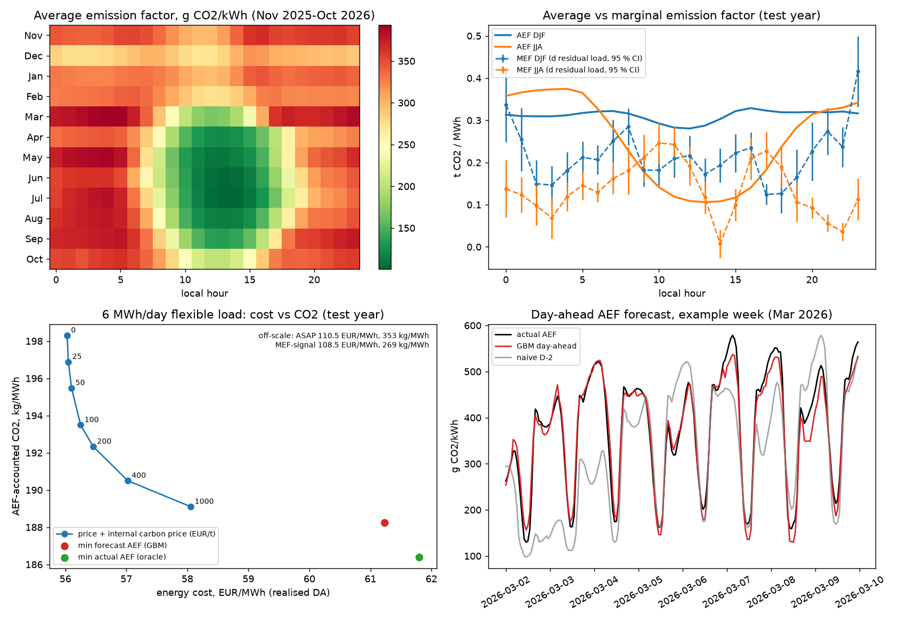

# Carbon-aware flexibility on the German grid: average vs marginal emissions, day-ahead carbon forecasts and what price-driven loads and batteries really do

When should a flexible load (EV fleet, heat pump pool, data-centre batch job) or a battery run in Germany if the goal is
lower CO2, not only a lower bill? This project builds an hourly CO2 intensity series for German public power generation
from **real public data** (Energy-Charts, Nov 2023 – Oct 2026, 26,304 hours). It estimates **marginal** emission factors,
forecasts the hourly intensity **day-ahead**, and then tests carbon-aware scheduling and battery arbitrage out of sample
on the year Nov 2025 – Oct 2026.



## Key results (test year 1 Nov 2025 – 31 Oct 2026, 363 complete days)

| | result |
|---|---|
| Bottom-up average emission factor (AEF), generation-weighted | **272 g CO2/kWh** (Nov 23–Oct 24: 273; Nov 24–Oct 25: 282), direct CO2 only |
| Agreement with the Energy-Charts published CO2eq series | hourly Pearson **0.991**, within-day Spearman **0.958**. The *level* differs: Energy-Charts mean 384 vs 289 g/kWh here (unweighted means) |
| Marginal emission factor (MEF, Δ domestic CO2 / Δ residual load) | mean **0.18 t/MWh**, below the AEF (0.29). Hourly MEF vs AEF correlation **−0.15**. Median bin R² only 0.30; train-vs-test bin correlation 0.62 |
| Who answers a residual-load change (test year, hourly Δ) | net imports **35 %**, hydro + pumped storage 28 %, gas 11 %, lignite 9 %, hard coal 5 %, biomass 3 % |
| Day-ahead AEF forecast (issued D-1 18:00), GBM | MAE **24.8 g/kWh** vs 91.0 naive D-2 and 73.8 price-only; within-day rank correlation 0.93 vs 0.62 |

**Flexible load, 6 MWh/day, 1 MW, any hour** (energy cost at realised DE-LU day-ahead prices):

| strategy | EUR/MWh | AEF-accounted kg/MWh | vs ASAP (AEF) | vs ASAP (MEF accounting) |
|---|---|---|---|---|
| ASAP (start at 00:00, uncontrolled) | 110.5 | 353 | – | – |
| **cheapest DA hours (price only)** | **56.0** | **198** | **−43.8 %** | **+22.2 %** |
| lowest *forecast* AEF (GBM) | 61.2 | 188 | −46.7 % | +24.0 % |
| lowest *actual* AEF (oracle) | 61.8 | 186 | −47.2 % | +24.0 % |
| price + internal carbon price 100 EUR/t on forecast AEF | 56.3 | 193 | −45.2 % | +24.0 % |
| lowest MEF (train-year MEF table) | 108.5 | 269 | −23.7 % | −13.8 % |

* **The price signal already does most of the AEF work.** Cheap German hours are windy or sunny hours. Moving the load
  to the cheapest hours halves its cost and cuts AEF-accounted CO2 by 44 %. Optimising directly on the carbon forecast
  saves only another **0.060 t/day (95 % CI 0.048–0.073)**, or 5 %, at +5.2 EUR/MWh. That works out to about **517 EUR per tonne**,
  far above the EU ETS price. An internal carbon price of 25–100 EUR/t in the objective captures 14–48 % of that extra
  reduction at **13–46 EUR/t**.
* **The day-ahead forecast is good enough to schedule on.** Scheduling on the GBM forecast gets 84 % of the oracle's
  extra AEF reduction (21.9 of 26.0 t/yr).
* **Negative/robustness result: AEF and MEF disagree.** Under MEF accounting, every price- or AEF-driven schedule
  *raises* emissions by 22–25 % relative to ASAP, and carbon-forecast scheduling is worse than price-only
  (+0.017 t/day, CI 0.007–0.027). In this estimate the night hours ASAP uses (00–06) have low marginal factors in spring and
  summer (0.07–0.15 t/MWh), while the midday solar hours that have the lowest *average* still have marginal
  factors of roughly 0.1–0.25 t/MWh, because a change in residual load there is partly met by domestic fossil plants. The MEF here is weakly identified (see
  limitations), so this is a warning that "low average = low marginal" is not safe, not a precise marginal number.
* With a **daytime window** (4 MWh between 08:00 and 18:00) almost everything is already solar hours: price-only gets
  −18.0 % AEF vs ASAP, and the carbon forecast adds only 0.0055 t/day.

**1 MW / 2 MWh battery, daily DA arbitrage LP** (88 % round trip, no wear cost, ASSUMED):

| objective | revenue EUR/yr | discharge MWh | CO2 attributed: AEF | MEF | Energy-Charts CO2eq |
|---|---|---|---|---|---|
| price only | 93,833 | 1,439 | **−48 t** | **+59 t** | −86 t |
| + 100 EUR/t on forecast AEF | 93,165 (−0.7 %) | 1,151 | −63 t | +56 t | −104 t |
| + 200 EUR/t on MEF | 84,891 (−9.5 %) | 1,326 | −46 t | −20 t | −78 t |

* Pure price arbitrage **lowers** CO2 under average-factor accounting but **raises** it under marginal accounting (+59 t/yr
  per MW). This is the same direction as Hittinger & Azevedo (2015) for the US: arbitrage charges in cheap hours whose
  marginal response is more carbon-intensive than that of the hours it discharges into. A carbon term on the *AEF* signal (up to 400 EUR/t tested) never turns the MEF result negative. A carbon price of about 200 EUR/t on the
  MEF signal turns it negative at a 9.5 % revenue cost.

## Problem

"Charge when the grid is green" products usually use **average** intensity, while the physical effect of an extra MWh
depends on which plants (or imports) respond, the **marginal** intensity. The two can rank hours differently. This project
asks three practical questions on public German data. (1) How well can hourly intensity be forecast for the next day?
(2) How much CO2 does carbon-aware scheduling save beyond plain price optimisation, and at what cost per tonne? (3) Do the
answers survive a switch from average to marginal accounting, for loads and for batteries?

## Method

1. **Data** (`scripts/fetch_data.py`, `scripts/build_dataset.py`): Energy-Charts API, Germany / DE-LU, 1 Nov 2023 – 31 Oct
   2026. Public net generation by source, load, residual load and cross-border balance (15-min → hourly means), the
   DE-LU day-ahead price (hourly, 15-min from Oct 2025 → hourly mean), TSO day-ahead forecasts of load, solar, onshore
   and offshore wind, and Energy-Charts' own published `co2eq` series (used only as a cross-check). No hour is missing.
2. **AEF** (`carbonflex.intensity`): direct CO2 of each fossil source = IPCC 2006 Guidelines default fuel factor
   (Vol. 2 Ch. 2 Table 2.2, energy industries: lignite 101,000, other bituminous coal 94,600, natural gas 56,100,
   residual fuel oil 77,400 kg CO2/TJ; municipal waste non-biomass fraction 91,700) divided by an **ASSUMED** fleet net
   efficiency (lignite 38 %, hard coal 42 %, gas 50 %, oil 38 %, waste 25 % with 50 % fossil share). Resulting
   factors: 0.957 / 0.811 / 0.404 / 0.733 / 0.660 t/MWh ([`results/emission_factors.csv`](results/emission_factors.csv)).
   Biomass is biogenic (0 direct fossil CO2). Coal-derived gas uses the hard-coal factor and "others" the gas factor (PROXIES).
   AEF = Σ CO2 / Σ net generation, production-based (imports ignored).
3. **MEF** (`carbonflex.mef`): regression of hourly first differences, ΔCO2 = a + β·Δ(residual load), separately for
   4 seasons × 24 local hours (Hawkes 2010; Siler-Evans et al. 2012). Fit on Nov 2023 – Oct 2025 as the **ex-ante signal**,
   refit on the test year as the **evaluation factor**. Δload as regressor is reported as a sensitivity.
4. **Forecast** (`carbonflex.forecast`): for every hour of day D, issued D-1 18:00 Europe/Berlin. Inputs: TSO day-ahead
   load/solar/wind forecasts for D, their residual and renewable share, the DE-LU day-ahead price for D (published about
   12:45 D-1), AEF of D-2 and D-7 at the same hour, AEF of D-1 hours 0–11 (mean) and hour 16, and calendar terms.
   Models: naive D-2 / D-7, ridge on price + hour only, ridge, HistGradientBoosting. Expanding window, monthly refits
   over the test year. A unit test checks that no lagged feature is newer than D-1 16:00.
5. **Scheduling** (`carbonflex.schedule`): for each local day, an energy-limited load (E MWh, ≤ 1 MW, allowed window)
   is put into the hours with the lowest signal (exact optimum, checked against brute force). Signals: none (ASAP),
   realised DA price, forecast AEF, actual AEF (oracle), train-year MEF, or price + λ·forecast AEF. Every schedule
   is scored on realised cost, actual AEF, test-year MEF and the Energy-Charts series. Day-level bootstrap CIs (2,000 draws).
6. **Battery** (`carbonflex.bess`): daily LP (HiGHS), 1 MW / 2 MWh, √0.88 per direction, SoC start = end = 50 %,
   objective = DA revenue − λ·Σ EF·(charge − discharge). Attributed CO2 = Σ EF·(charge − discharge).

## How to run

```bash
python -m venv .venv && source .venv/bin/activate
pip install -r requirements.txt && pip install -e .
python -m pytest -q                 # 11 tests, ~2 s
python scripts/run_all.py           # ~35 s: all results/ tables, results/summary.json, figures/overview.png
# rebuild the data from the API (about 250 requests, ~10 min, cached in data/raw/):
python scripts/fetch_data.py && python scripts/build_dataset.py
```

`data/processed/hourly_de.csv.gz` (2.2 MB) is the processed hourly input, so `run_all.py` works offline.
Results: `aef_validation.csv`, `mef_*.csv`, `forecast_metrics.csv`, `schedule_results.csv`, `bess_emissions.csv`,
`summary.json` (incl. bootstrap CIs and the residual-load response shares). A CI example is in
[`docs/ci-example.yml`](docs/ci-example.yml).

```
src/carbonflex/  data.py (parse/resample Energy-Charts), intensity.py (factors, AEF), mef.py (binned ΔCO2/ΔX regression),
                 forecast.py (ex-ante features, rolling backtest, metrics), schedule.py (energy-limited load), bess.py (LP)
scripts/         fetch_data.py, build_dataset.py, run_all.py
tests/           factor arithmetic, AEF edge cases, 15-min→hourly, name mapping, schedule optimality vs brute force,
                 masks/capacity, BESS LP energy balance and carbon price, MEF slope recovery, forecast feature timing
```

## Assumptions (all labelled in code and results)

* Plant **efficiencies are ASSUMED fleet averages**, not plant data. A ±10 % error in an efficiency scales that source's
  factor by about ∓10 %. Hourly *ranking* (what scheduling uses) is much less sensitive than the level.
* CHP plants: all fuel CO2 is charged to electricity at the assumed electric efficiency (no heat credit).
* Waste fossil share 50 %, coal-derived gas = hard-coal factor, "others" = gas factor: **PROXIES** for about 3 % of generation.
* Battery: 88 % round trip, no wear cost, DA prices known when the schedule is set (true after the D-1 auction), no
  reserve markets. Loads are price-takers (1 MW does not move prices).

## Limitations

* **Production-based, direct CO2 only.** Imports, upstream/lifecycle emissions and non-CO2 gases are excluded. This is
  the likely main reason the Energy-Charts CO2eq level is about 95 g/kWh higher; its methodology was not reproduced here.
  The two series rank hours almost identically.
* **The MEF is weakly identified.** Median bin R² is 0.30 and the bins only partly agree between years (r = 0.62). It
  measures the *domestic* emission response only, while 35 % of a residual-load change is met by net imports. If imports
  were gas-fired at the margin the import-adjusted mean MEF would be about 0.32 t/MWh, and 0.51 if they were lignite. This
  regression captures short-run, average-over-conditions marginal responses, not dispatch-model marginal units.
  The MEF conclusions are directional.
* Energy-Charts' own CO2 forecast is only kept for the near future, so it could not be benchmarked historically.
* One country, one test year, a stylised load and battery. No real trading or real-money result is claimed.

## Data and licences

* **Energy-Charts.info** (Fraunhofer ISE), `api.energy-charts.info`: public power, price, day-ahead forecasts and CO2eq
  series. Licence **CC BY 4.0** (price data credited by the API as "Bundesnetzagentur | SMARD.de"). The processed hourly
  file in `data/processed/` is a derivative under the same licence. Please credit Energy-Charts / Fraunhofer ISE.
* Emission factors: *2006 IPCC Guidelines for National Greenhouse Gas Inventories*, Vol. 2 Energy, Ch. 2 Stationary
  Combustion, Table 2.2 (default values checked against the IPCC PDF, 2026-11-26).

## References (DOIs checked on Crossref, 2026-11-26)

* Hawkes, A. D. (2010). Estimating marginal CO2 emissions rates for national electricity systems. *Energy Policy* 38(10).
  doi:10.1016/j.enpol.2010.05.053
* Siler-Evans, K., Azevedo, I. L., Morgan, M. G. (2012). Marginal emissions factors for the U.S. electricity system.
  *Environ. Sci. Technol.* 46. doi:10.1021/es300145v
* Hittinger, E. S., Azevedo, I. M. L. (2015). Bulk energy storage increases United States electricity system emissions.
  *Environ. Sci. Technol.* 49. doi:10.1021/es505027p
* IPCC (2006). *2006 IPCC Guidelines for National Greenhouse Gas Inventories*, Vol. 2, Ch. 2.

Related repositories by the same author (not duplicated here): `de-day-ahead-price-forecasting`,
`de-solar-cannibalisation-bess`, `clean-spreads-fuel-switching-de`.

## License

MIT (code). Data: CC BY 4.0, see above.
